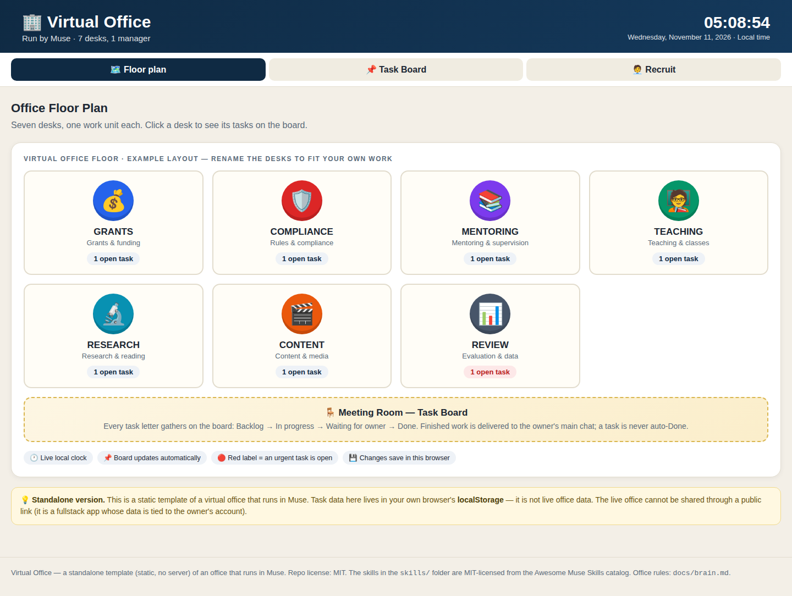
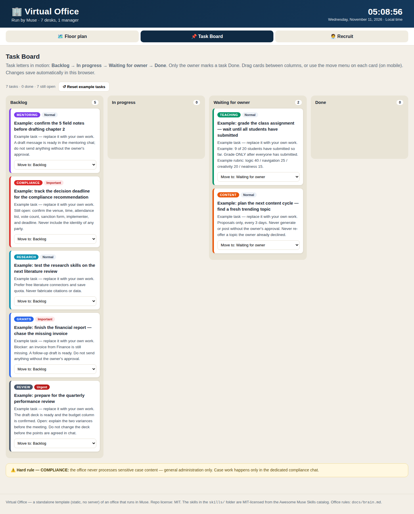
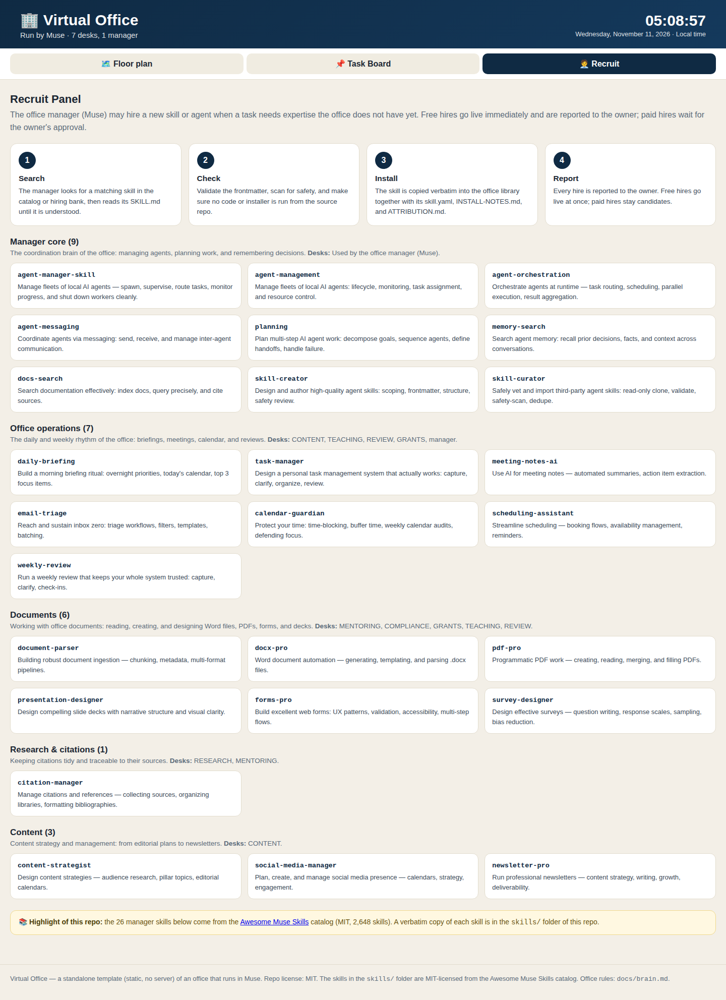

Read in English: [README.md](README.md)

# Kantor Virtual — Muse AI

Kantor virtual yang dijalankan oleh **Muse** (manajer kantor "Kadal Budug") untuk **Bos Rifki** — tujuh meja, satu papan tugas, dan pustaka 26 skill manajer. Repo ini berisi pembangunan ulang kantor sebagai aplikasi mandiri yang statis, plus pustaka skill yang menggerakkannya.

> **Jujur dulu:** kantor yang live berjalan di dalam Muse sebagai aplikasi fullstack, dan tidak bisa dibagikan lewat tautan publik (datanya terikat akun pemiliknya). Repo ini adalah pembangunan ulang yang setia dan mandiri: aplikasi kantor di `office/` berjalan offline dari satu file HTML dan menyimpan datanya di `localStorage` peramban. Ini demo dan titik awal — bukan kantor live-nya.

## Screenshot


*Denah 2D — tujuh meja, satu karakter chibi per unit, jam WIB berjalan.*


*Papan tugas — Antre → Dikerjakan → Menunggu Bos → Selesai.*


*Panel Rekrut — skill yang terpasang dan cara kerja perekrutan.*

## Tujuh meja

| Meja | Unit | Lingkup |
|------|------|---------|
| 🎓 **BIMA** | Beasiswa & Pemagangan | KIP-K, beasiswa, magang, LPJ keuangan, deck SPI |
| 🛡️ **SATYA** | Satgas PPKPT | Satgas pencegahan kekerasan kampus — administrasi umum saja |
| 📚 **BIMBING** | Skripsi | Pendamping skripsi (Dian & Izal) — mentor, bukan pembimbing resmi |
| 🧑‍🏫 **NGAJAR** | Pengajaran | Pemrograman Mobile (Kotlin/Android) & Desain Web, daring |
| 🔬 **RISET** | Riset | Penelitian, pencarian literatur lewat konektor gratis Consensus / OpenAlex |
| 🎬 **KABAR** | Konten & Media | Digest berita harian, konten Facebook, usulan reels |
| 📊 **AUDIT** | Evaluasi & Data | Evaluasi kinerja, rekap data, laporan terverifikasi |

## Cara kerja papan tugas

Setiap pekerjaan masuk sebagai *Surat Tugas* dan bergerak melalui empat kolom:

**Antre → Dikerjakan → Menunggu Bos → Selesai**

- Prosesor kantor mengerjakan tugas berstatus **Dikerjakan** (tiap 30 menit di kantor live).
- Hasil kerja diantar ke chat utama dan tugas pindah ke **Menunggu Bos** — tidak pernah otomatis **Selesai**.
- **Hanya Bos yang menandai Selesai.**

### Otonomi manajer (disetujui 10 Nov 2026)

- Tugas yang Bos tulis sendiri dikerjakan otomatis, tanpa Bos menekan "Mulai kerjakan".
- Otonomi hanya untuk pekerjaan internal: draf, dokumen, riset, persiapan.
- Apa pun yang butuh mengirim pesan/email, posting, membayar/berlangganan, generate video/paket reels, atau menyentuh isi kasus PPKPT dipindah ke **Menunggu Bos** dengan catatan kenapa butuh Bos.
- Pengingat tenggat untuk tugas penting/mendesak: maks 1x per tugas per hari.
- Manajer boleh hire skill/agen **gratis** sendiri dan melaporkan tiap hire; hire berbayar tetap kandidat sampai Bos menyetujui.

### Aturan keras — SATYA

Kantor **tidak pernah memproses isi kasus PPKPT** (nama/inisial pihak, BA, rekomendasi, pemanggilan). Pekerjaan kasus hanya di obrolan PPKPT. Yang boleh dikerjakan di kantor: administrasi umum — daftar hadir, template, jadwal, penomoran surat.

## ⭐ Sorotan utama: 26 skill manajer

Fokus utama repo ini adalah **26 skill manajer** pilihan dari katalog [Awesome Muse Skills](https://github.com/aicodedecode/awesome-muse-skills) (MIT, 2.648 skill), dipasang 10 November 2026. Tiap skill disalin **verbatim** ke `skills/` beserta `SKILL.md`, `skill.yaml`, `INSTALL-NOTES.md`, dan `ATTRIBUTION.md`.

- **Inti manajer (9):** agent-manager-skill, agent-management, agent-orchestration, agent-messaging, planning, memory-search, docs-search, skill-creator, skill-curator
- **Operasional kantor (7):** daily-briefing, task-manager, meeting-notes-ai, email-triage, calendar-guardian, scheduling-assistant, weekly-review
- **Dokumen (6):** document-parser, docx-pro, pdf-pro, presentation-designer, forms-pro, survey-designer
- **Riset & sitasi (1):** citation-manager
- **Konten (3):** content-strategist, social-media-manager, newsletter-pro

Detail, pengelompokan, pemetaan ke meja, dan apa yang sengaja *tidak* dipasang: lihat [skills/INSTALL-NOTES.md](skills/INSTALL-NOTES.md).

## Aplikasi mandiri

Buka [`office/index.html`](office/index.html) langsung di peramban — tanpa build step, tanpa server, tanpa dependensi eksternal, semua inline, jalan offline:

- **Denah** (`#denah`): denah 2D dengan tujuh meja dan karakter chibi per unit, jam WIB berjalan, jumlah tugas terbuka.
- **Papan Tugas** (`#papan`): papan empat kolom dengan 7 tugas awal yang nyata. Seret kartu antar kolom, atau pakai menu pindah di tiap kartu (ramah sentuhan). Perubahan tersimpan di `localStorage`.
- **Rekrut** (`#rekrut`): proses perekrutan dan 26 skill yang terpasang, dikelompokkan beserta pemetaan mejanya.

Tampilan bisa diakses lewat hash URL: `#denah` (default), `#papan`, `#rekrut`.

## Struktur repo

```
.
├── README.md                  # Versi Bahasa Inggris
├── README.id.md               # File ini (Bahasa Indonesia)
├── LICENSE                    # MIT
├── office/
│   └── index.html             # Aplikasi kantor mandiri (satu file, offline)
├── skills/
│   ├── INSTALL-NOTES.md       # 26 skill: kelompok, pemetaan meja, yang dilewati
│   └── <26 folder skill>/     # Salinan verbatim: SKILL.md + skill.yaml + catatan
└── docs/
    ├── brain.md               # Otak kantor: aturan tiap unit, otonomi, perekrutan
    └── screenshots/           # Denah 2D, papan tugas, panel Rekrut
```

## Aturan yang mengatur kantor ini

Aturan lengkap ada di [docs/brain.md](docs/brain.md). Versi singkatnya:

- Bahasa Indonesia. Panggil bos dengan "Bos Rifki".
- Jangan kirim pesan/email atas nama Bos tanpa persetujuannya — draf dulu, Bos yang menyetujui.
- Jangan mengarang data, angka, sitasi, atau nama. Kalau belum terverifikasi, tulis begitu.
- Bos istirahat 12.00–13.00 WIB: jangan jadwalkan pekerjaan di jam itu.
- Caption IG reels: maksimal 120 **KARAKTER**.
- Aturan deck: bahas poin di chat sampai satu pemahaman dulu, baru buat deck.
- Video: render dari kode (Remotion / bang-motion), BUKAN generate video AI. Tawarkan pilihan gaya motion dulu sebelum generate.

## Lisensi

MIT — lihat [LICENSE](LICENSE). Skill-skill di `skills/` berlisensi MIT dari kontributor Awesome Muse Skills; tiap folder menyimpan `ATTRIBUTION.md`-nya sendiri.
