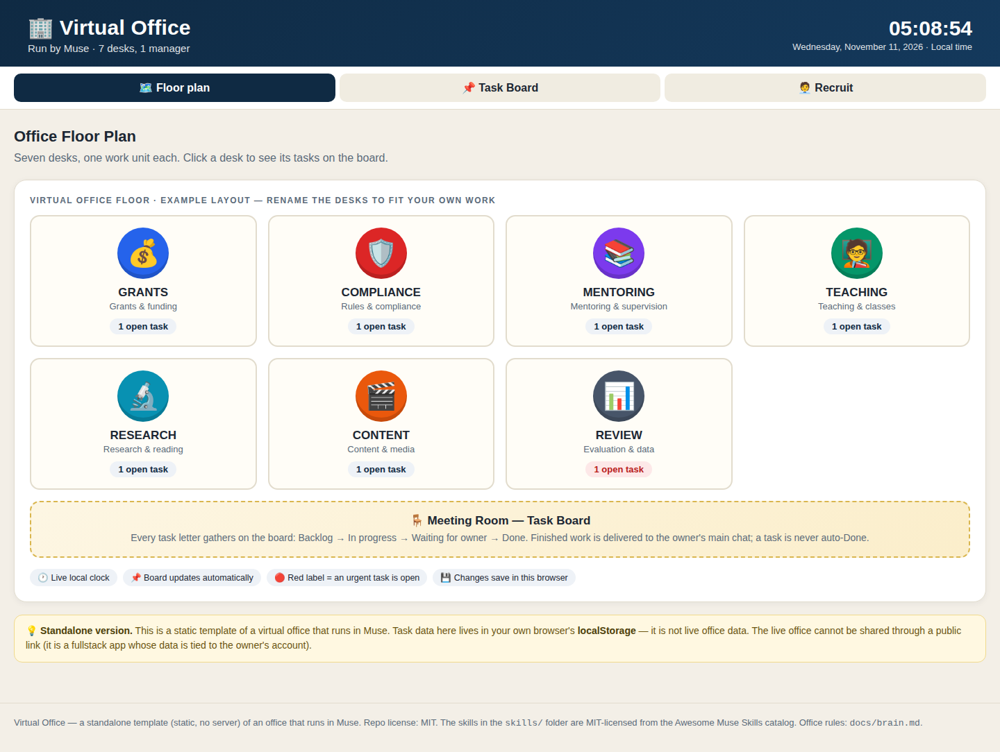
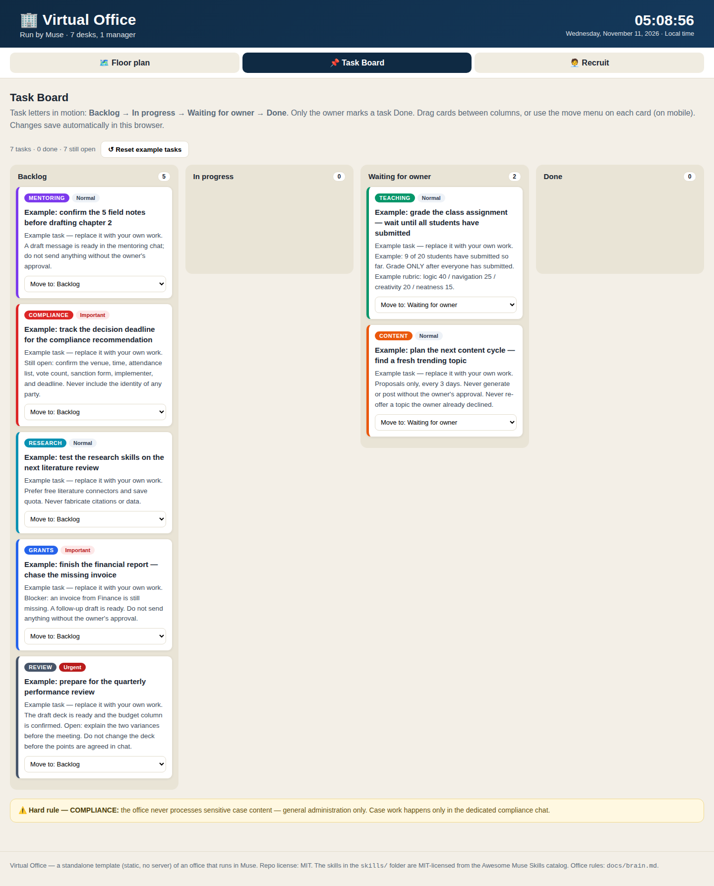
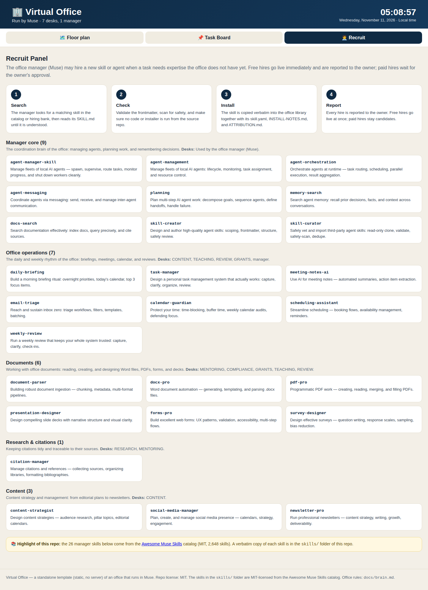

Baca dalam Bahasa Indonesia: [README.id.md](README.id.md)

# Virtual Office — Muse AI

A virtual office template run by **Muse** — your AI office manager. Seven desks, one task board, and a library of 26 manager skills. Use it to run your own work the way an office would: tasks arrive as letters, desks handle them, and finished work comes back to you for approval.

> **Honest note:** the live office runs inside Muse as a fullstack app, and it cannot be shared through a public link (its data is tied to the owner's account). This repo is the standalone template version: the office app in `office/` runs offline from a single HTML file and stores its data in your browser's `localStorage`. It is a demo and a starting point — not a live office.

## Screenshots


*2D floor plan — seven desks, one character per desk, live local clock.*


*Task board — Backlog → In progress → Waiting for owner → Done.*


*Recruit panel — the installed skills and how hiring works.*

## The seven desks (examples — rename them to fit your work)

| Desk | Scope |
|------|-------|
| 💰 **GRANTS** | Grants & funding |
| 🛡️ **COMPLIANCE** | Rules & compliance |
| 📚 **MENTORING** | Mentoring & supervision |
| 🧑‍🏫 **TEACHING** | Teaching & classes |
| 🔬 **RESEARCH** | Research & reading |
| 🎬 **CONTENT** | Content & media |
| 📊 **REVIEW** | Evaluation & data |

The desks are examples. Rename them, change their scopes, or add new ones in `office/index.html` (`UNITS`) and in `docs/brain.md`.

## How the task board works

Every assignment enters as a *task letter* and moves through four columns:

**Backlog → In progress → Waiting for owner → Done**

- The office processor works on tasks in **In progress**.
- Finished work is delivered to the owner's main chat and the task moves to **Waiting for owner** — never to **Done** automatically.
- **Only the owner marks a task Done.**

### Manager autonomy (template, opt-in)

Autonomy is off by default. Turn it on only for task types you trust, and only after the owner agrees:

- Tasks the owner writes with an `auto=true` mark run automatically, without pressing "Start".
- Autonomy covers internal work only: drafts, documents, research, preparation.
- Anything that needs sending a message/email, posting, paying/subscribing, generating a video or content package, or touching sensitive case content goes to **Waiting for owner** with a note explaining why the owner is needed.
- Deadline reminders for important/urgent tasks: at most once per task per day.
- The manager may hire **free** skills/agents on its own and reports each hire; paid hires stay candidates until the owner approves.

### Hard rule — COMPLIANCE

The office **never processes sensitive case content** (names/initials of parties, minutes, recommendations, summons). Case work happens only in the dedicated compliance chat. The office only handles general administration: attendance lists, templates, schedules, letter numbering.

## ⭐ The highlight: 26 manager skills

The main focus of this repo is the **26 manager skills** chosen from the [Awesome Muse Skills](https://github.com/aicodedecode/awesome-muse-skills) catalog (MIT, 2,648 skills). Each skill is copied **verbatim** into `skills/` with its `SKILL.md`, `skill.yaml`, `INSTALL-NOTES.md`, and `ATTRIBUTION.md`.

### Manager core (9)

| Skill | What it does |
|-------|--------------|
| `agent-manager-skill` | Manage fleets of local AI agents — spawn, supervise, route tasks, monitor progress, and shut down workers cleanly. |
| `agent-management` | Manage fleets of local AI agents: lifecycle, monitoring, task assignment, and resource control. |
| `agent-orchestration` | Orchestrate agents at runtime — task routing, scheduling, parallel execution, result aggregation. |
| `agent-messaging` | Coordinate agents via messaging: send, receive, and manage inter-agent communication. |
| `planning` | Plan multi-step AI agent work: decompose goals, sequence agents, define handoffs, handle failure. |
| `memory-search` | Search agent memory: recall prior decisions, facts, and context across conversations. |
| `docs-search` | Search documentation effectively: index docs, query precisely, and cite sources. |
| `skill-creator` | Design and author high-quality agent skills: scoping, frontmatter, structure, safety review. |
| `skill-curator` | Safely vet and import third-party agent skills: read-only clone, validate, safety-scan, dedupe. |

### Office operations (7)

| Skill | What it does |
|-------|--------------|
| `daily-briefing` | Build a morning briefing ritual: overnight priorities, today's calendar, top 3 focus items. |
| `task-manager` | Design a personal task management system that actually works: capture, clarify, organize, review. |
| `meeting-notes-ai` | Use AI for meeting notes — automated summaries, action item extraction. |
| `email-triage` | Reach and sustain inbox zero: triage workflows, filters, templates, batching. |
| `calendar-guardian` | Protect your time: time-blocking, buffer time, weekly calendar audits, defending focus. |
| `scheduling-assistant` | Streamline scheduling — booking flows, availability management, reminders. |
| `weekly-review` | Run a weekly review that keeps your whole system trusted: capture, clarify, check-ins. |

### Documents (6)

| Skill | What it does |
|-------|--------------|
| `document-parser` | Building robust document ingestion — chunking, metadata, multi-format pipelines. |
| `docx-pro` | Word document automation — generating, templating, and parsing .docx files. |
| `pdf-pro` | Programmatic PDF work — creating, reading, merging, and filling PDFs. |
| `presentation-designer` | Design compelling slide decks with narrative structure and visual clarity. |
| `forms-pro` | Build excellent web forms: UX patterns, validation, accessibility, multi-step flows. |
| `survey-designer` | Design effective surveys — question writing, response scales, sampling, bias reduction. |

### Research & citations (1)

| Skill | What it does |
|-------|--------------|
| `citation-manager` | Manage citations and references — collecting sources, organizing libraries, formatting bibliographies. |

### Content (3)

| Skill | What it does |
|-------|--------------|
| `content-strategist` | Design content strategies — audience research, pillar topics, editorial calendars. |
| `social-media-manager` | Plan, create, and manage social media presence — calendars, strategy, engagement. |
| `newsletter-pro` | Run professional newsletters — content strategy, writing, growth, deliverability. |

Details, groupings, desk mapping, and what was deliberately *not* installed: see [skills/INSTALL-NOTES.md](skills/INSTALL-NOTES.md).

## How to use it in Muse

1. **Clone or download this repo** (or copy the `skills/` folder and `docs/brain.md`).
2. **Copy the skills you need** into Muse's custom-skills folder, `~/workspace/custom-skills/` — each skill as its own folder (`agent-manager-skill/`, `task-manager/`, …). Copy the ones you need; you do not have to take all 26.
3. **Copy `docs/brain.md`** into your workspace as the office brain, and **fill in every `[BRACKET]`** with your own desks, names, hours, and rules.
4. **Open `office/index.html` in a browser** — no build step, no server. Your tasks are stored in that browser's `localStorage`.
5. **Ask Muse to be your office manager** following your brain file: route tasks to desks, work on them, deliver results to your main chat, and move finished tasks to "Waiting for owner".
6. **Make it yours:** edit `UNITS` and `SEED_TASKS` in `office/index.html` (desk names, scopes, example tasks) and the per-desk sections in `docs/brain.md`.
7. **Hire new skills when a task needs them:** search the [Awesome Muse Skills](https://github.com/aicodedecode/awesome-muse-skills) catalog, then install with `skill-curator` / `skill-creator` (read-only clone, validate the frontmatter, safety-scan, never run code or installers from the source repo, dedupe by content). Free hires go live at once and are reported; paid hires wait for your approval.

## How to use it without Muse

The board works on its own: open `office/index.html` in any browser. Drag task cards between columns, or use the move menu on each card (touch-friendly). The "Reset example tasks" button restores the 7 example tasks. No account, no server, no data leaves your browser.

## Customization

- **Desks:** edit the `UNITS` array in `office/index.html` (id, name, role, emoji, color) and the matching section in `docs/brain.md`.
- **Example tasks:** edit `SEED_TASKS` in `office/index.html`. Replace the examples with your real tasks, or clear them and start empty.
- **Statuses:** the four columns are `Backlog`, `In progress`, `Waiting for owner`, `Done` (`STATUSES` in the file). Rename them if your workflow uses other words.
- **Skills:** add or remove folders under `skills/` and update the `SKILL_GROUPS` list in `office/index.html` so the Recruit panel matches.
- **Rules:** everything the office follows lives in `docs/brain.md` — edit it first, the office follows what is written there.

## Repository layout

```
.
├── README.md                  # This file (English)
├── README.id.md               # Bahasa Indonesia version
├── LICENSE                    # MIT
├── office/
│   └── index.html             # Standalone office app (single file, offline)
├── skills/
│   ├── INSTALL-NOTES.md       # The 26 skills: groups, desk mapping, what was skipped
│   └── <26 skill folders>/    # Verbatim copies: SKILL.md + skill.yaml + notes
└── docs/
    ├── brain.md               # The office brain template: rules per desk, autonomy, hiring
    └── screenshots/           # 2D floor plan, task board, recruit panel
```

## Rules that govern this office

Full rules live in [docs/brain.md](docs/brain.md). The short version:

- Work in the owner's language; address the owner as agreed in the brain file.
- Never send a message or email on the owner's behalf without their approval — draft first, the owner approves.
- Never fabricate data, numbers, citations, or names. If it is unverified, say so.
- Respect the owner's quiet hours: no work scheduled in that window.
- A task is never auto-Done — only the owner marks it Done.
- Free hires go live and are reported; paid hires wait for approval.

## License & attribution

MIT — see [LICENSE](LICENSE). The skills in `skills/` are MIT-licensed from the [Awesome Muse Skills](https://github.com/aicodedecode/awesome-muse-skills) contributors; each folder keeps its own `ATTRIBUTION.md`.
